# 🏝️ Awesome On-Demand Sandbox Environments

  

  
  
  
  
  
  
  

---

> 🚀 **A curated directory of top SaaS platforms and open-source GitHub projects for ephemeral preview environments, isolated testing sandboxes, AI code runner isolation, and on-demand cloud infrastructure provisioning.**

---

## 📑 Table of Contents

- [🌐 Sector Overview & Market Dynamics](#-sector-overview--market-dynamics)
- [☁️ SaaS & Hosted Platforms](#️-saas--hosted-platforms)
- [💻 Open-Source GitHub Projects](#-open-source-github-projects)
- [🏗️ Recommended Architecture Stacks](#️-recommended-architecture-stacks)
- [📈 Star History](#--star-history)
- [💖 Support & Sponsorship](#-support--sponsorship)
- [🤝 How to Contribute](#-how-to-contribute)
- [⚖️ Disclaimer](#️-disclaimer)

---

## 🌐 Sector Overview & Market Dynamics

The **On-Demand Sandbox Environments** and **Environments-as-a-Service (EaaS)** market sits at the intersection of Test Environment as a Service (TEaaS) — estimated at **$17.7B+** and expanding toward **$63.4B** — and cloud-native developer tooling.

The sector remains **moderately fragmented**: mega-cap hyperscalers (AWS, Salesforce) anchor proprietary enterprise sandboxing, while specialized high-growth startups (Okteto, Bunnyshell, Qovery, Signadot) and flexible open-source solutions compete aggressively for Kubernetes-native microservices, pull-request previews, and AI agent execution sandboxes.

---

## ☁️ SaaS & Hosted Platforms

The table below details leading commercial and hosted platforms offering on-demand preview and sandbox environments. Companies are **sorted in descending order by company valuation / market scale**.

| Platform | Valuation / Market Scale | Pricing (Starting Tier) | Free Tier Limits / Trial | Core Capabilities & Focus |
| :--- | :--- | :--- | :--- | :--- |
| **[AWS DevTest & Builder Labs](https://aws.amazon.com/)** | **~$2.7T+** (Amazon Market Cap; AWS ~$1.0T+ SOTP) | **Pay-as-you-go** ($0.0116/hr for `t4g.nano` instances) | **Always Free Tier** + **100% Free 8-hour sandboxes** (via AWS Builder Center, 1 sandbox/week, no credit card required) | Enterprise cloud sandbox accounts, automated teardown policies, cost ceilings, and cloud-native testing labs. |
| **[Salesforce Sandbox On-Demand](https://www.salesforce.com/)** | **~$190B+** (Salesforce Market Cap) | **Developer Sandbox included** with Enterprise/Unlimited licenses; add-on Developer Pro at **5% of net spend** | **Free Developer Sandbox** included with active CRM editions (1 copy, 200 MB test data, single org) | Rapid metadata copies and on-demand sandbox provisioning for development, staging, and automated CI/CD testing. |
| **[Qovery](https://www.qovery.com/)** | **~$30M – $50M** (Series A, backed by Crane & Speedinvest) | **$299 / month** (Team plan, billed annually) | **Free Forever Plan** (Unlimited developers, 1 cluster, community support, preview environments enabled) | DevOps-friendly Environment-as-a-Service on top of AWS, GCP, and Kubernetes with instant preview URLs. |
| **[Release.com](https://release.com/)** | **~$30M – $50M** (Series A, $20M raised from CRV) | **$100 / month** (Starter base tier / custom contract) | **14-day free trial** with full platform capabilities, no upfront contract required | Environments-as-a-Service creating isolated, full-stack preview staging environments per branch or PR. |
| **[Okteto](https://www.okteto.com/)** | **~$50M – $100M** (Series A, $15M raised from Two Sigma) | **Custom annual contract** (Scale & Enterprise tiers billed per seat) | **Free Forever Starter Plan** (Free for up to 5 seats on self-hosted Kubernetes / BYOC clusters) | Kubernetes development platform powering cloud dev environments, PR preview URLs, and remote debugging. |
| **[Signadot](https://www.signadot.com/)** | **~$15M – $30M** (Seed / Early Stage, Y Combinator backed) | **Usage-based tier** with caps up to **$2,050 / month** | **Free Forever Plan** (Up to 50 sandboxes/mo, 100 test runs/mo, 10 devboxes, 1 cluster, 1 resource plugin) | Lightweight Kubernetes microservice sandboxing using request-level routing, multitenancy, and contract testing. |
| **[Bunnyshell](https://www.bunnyshell.com/)** | **~$15M – $25M** ($11.5M total venture funding) | **$0.007 / minute** active environment runtime ($0 when sleeping) | **14-day free trial** with full feature set, unlimited users, and Bring-Your-Own-Cloud (BYOC) support | EaaS platform spinning up microservice environments per PR with sub-second Firecracker AI sandboxes. |
| **[Shipyard](https://shipyard.build/)** | **Acquired by StackGen** ($15M+ valuation scale) | **$500 / month** (Startup plan with 3 concurrent Drydocks, +$100/mo per extra Drydock) | **30-day free trial** (No credit card required, 3 concurrent preview environments) | Ephemeral environments platform for full-stack preview deployments, GitOps testing, and Docker Compose apps. |
| **[Uffizzi](https://www.uffizzi.com/)** | **~$5M – $15M** (Early-stage venture backed) | **$20 / month** (Starter tier for small teams) | **Free Forever Plan** (Up to 2 concurrent preview environments, open-source core, community support) | Containerized preview environments per PR with open-source core architecture and multi-cloud deployment. |
| **[Webapp.io](https://webapp.io/)** | **Acquired by Harness** (~$10M – $20M exit scale) | **$15 / user / month** (Pro tier; platform acquired by Harness) | **Free Forever Plan** (Up to 3 members, 2 concurrent virtual machines, 1 hosted domain) | Full-stack preview environment and CI/CD platform with Layerfile VM snapshots and database cloning. |
| **[Velocity.tech](https://velocity.tech/)** | **~$10M – $20M** (Early stage / acquired tech assets) | **Custom contract** (Tailored team pricing) | **14-day free trial** upon scheduling product consultation | On-demand engineering intelligence and ephemeral testing orchestration platform. |

---

## 💻 Open-Source GitHub Projects

Curated open-source projects for self-hosting ephemeral environments, Kubernetes virtualization, and local cloud sandboxing. **Sorted in descending order by GitHub_Stars ⭐**.

| Project | GitHub_Stars | Focus & Description |
| :--- | :--- | :--- |
| **[Daytona](https://github.com/daytonaio/daytona)** |  | Open-source development environment manager and infrastructure engine for securely spinning up standardized dev sandboxes and AI agent workspaces in seconds. |
| **[LocalStack](https://github.com/localstack/localstack)** |  | Fully functional local AWS cloud stack. Spin up mock S3, Lambda, DynamoDB, SQS, and 40+ cloud services locally without incurring AWS charges or internet access. |
| **[Skaffold](https://github.com/GoogleContainerTools/skaffold)** |  | Google's CLI tool that facilitates continuous development for Kubernetes applications. Automatically detects source code changes, rebuilds, and redeploys to your sandbox cluster. |
| **[Devbox](https://github.com/jetify-com/devbox)** |  | Instant, reproducible, and isolated developer environments powered by Nix without requiring Nix knowledge. Ideal for ephemeral container or local sandbox bootstrapping. |
| **[vCluster](https://github.com/loft-sh/vcluster)** |  | Virtual Kubernetes clusters running inside a single physical namespace. Provides multi-tenant, zero-leak Kubernetes sandboxes that provision in seconds. |
| **[Tilt](https://github.com/tilt-dev/tilt)** |  | Open-source toolkit automating microservice dev loops. Manages local or remote Kubernetes sandboxes with live updates to containers and a central web UI dashboard. |
| **[Telepresence](https://github.com/telepresenceio/telepresence)** |  | Two-way network proxy establishing a secure bridge between your local machine and remote Kubernetes/OpenShift sandbox clusters for fast testing cycles. |
| **[k3d](https://github.com/k3d-io/k3d)** |  | Ultra-fast utility running Rancher's CNCF-certified lightweight k3s inside Docker. Enables instant local Kubernetes sandbox clusters with near-zero overhead. |
| **[DevSpace](https://github.com/devspace-sh/devspace)** |  | Fast developer tool for Kubernetes. Automates container builds, image pushing, deployment, and live debugging inside remote or ephemeral sandbox environments. |
| **[Garden](https://github.com/garden-io/garden)** |  | Development and testing orchestration platform for Kubernetes. Spins up production-like preview environments on-demand with intelligent build caching. |
| **[Preevy](https://github.com/livecycle/preevy)** |  | CLI tool that provisions ephemeral preview environments directly from Docker Compose to AWS Lightsail, GCP Cloud Run, or Kubernetes per pull request. |
| **[miniblue](https://github.com/moabukar/miniblue)** |  | Free, open-source local Azure emulator. Provides 25+ emulated Azure services (Blob, Key Vault, Cosmos DB, Functions) in a lightweight ~8MB Docker container. |
| **[PullPreview](https://github.com/pullpreview/action)** |  | GitHub Action that provisions on-demand preview environments on any cloud VPS for pull requests using Docker Compose. |
| **[Ergomake](https://github.com/briefercloud/ergomake)** |  | Self-hosted preview environments for every pull request on any tech stack. Spawns ephemeral test environments from Docker Compose definitions. |
| **[Sarthi](https://github.com/tushar5526/sarthi)** |  | "Vercel for Backend" — easily launch ephemeral preview environments and staging deployments using just Docker containers. |
| **[Open-Sandboxes](https://github.com/AstraBert/open-sandboxes)** |  | Python-native, self-hosted alternative to Cloudflare Sandbox SDK. Creates lightweight ephemeral Docker containers for executing untrusted code. |
| **[ReleaseDesk](https://github.com/brewbits-co/releasedesk)** |  | Open-source, self-hostable release distribution hub with preview channels, staging tracking, and CI/CD automation pipelines. |
| **[Signadot CLI](https://github.com/signadot/cli)** |  | Official command-line interface for managing multi-tenant Kubernetes sandboxes, preview routing rules, and CI/CD test automation. |
| **[K8s Ephemeral Environments](https://github.com/koder-cat/k8s-ephemeral-environments)** |  | Full-stack preview environments with dedicated databases for every PR. Self-hosted alternative to Vercel/Qovery running on k3s with Grafana/Prometheus observability. |

---

## 🏗️ Recommended Architecture Stacks

For teams engineering their own custom **On-Demand Ephemeral Sandbox Platform**, the following modular combinations are standard across the industry:

1. **Kubernetes Multi-Tenancy**: Use **[vCluster](https://github.com/loft-sh/vcluster)** or **[k3d](https://github.com/k3d-io/k3d)** for fast, isolated namespace/cluster partitioning.
2. **Traffic Routing & Service Mocking**: Use **[Signadot CLI](https://github.com/signadot/cli)** or **[Telepresence](https://github.com/telepresenceio/telepresence)** for selective request routing, and **[LocalStack](https://github.com/localstack/localstack)** / **[miniblue](https://github.com/moabukar/miniblue)** for cloud service emulation.
3. **Developer Workloop Automation**: Pair **[Tilt](https://github.com/tilt-dev/tilt)** or **[Skaffold](https://github.com/GoogleContainerTools/skaffold)** with **[Daytona](https://github.com/daytonaio/daytona)** to give developers instant, remote workspaces.
4. **Pull-Request Lifecycle Automation**: Leverage **[Preevy](https://github.com/livecycle/preevy)** or **[PullPreview](https://github.com/pullpreview/action)** to spin up and tear down environments via GitHub Actions.

---

## 📈 Star History

---

## 💖 Support & Sponsorship

If you find this curated collection helpful for your engineering team, architecture planning, or DevOps workflows, please consider supporting the project:

- ⭐ **Star this repository** to help others discover it on GitHub.
- 🍴 **Fork it** to maintain your personal references and contribute additions.
- 📣 **Share it** with platform engineers, DevOps peers, and developer communities.
- ☕ **Buy a coffee & sponsor**: Support continuous maintenance and updates via the [GitHub Sponsor Dashboard](https://github.com/sponsors/ishandutta2007).

  

---

## 🤝 How to Contribute

Contributions are welcome! Please follow these guidelines:

1. 🍴 **Fork** this repository.
2. 🌿 Create a feature branch: `git checkout -b add-sandbox-tool`.
3. 📝 Update `README.md` keeping the tabular format, exact pricing, free-tier limitations, and GitHub Stars_Counts.
4. 🚀 Submit a **Pull Request** with a concise description of the tool and its category.

Please ensure all linked platforms and repositories are actively maintained and adhere to community guidelines.

---

## ⚖️ Disclaimer

- This repository is a **community-curated index** created for educational and informational purposes. Mention does not constitute an endorsement.
- All trademarks, service marks, company names, and logos belong to their respective owners.
- Sandbox platforms handle sensitive code and infrastructure; always enforce strict security controls, egress filters, and credential safeguards before deploying workloads.

---

  <b>Built with ❤️ for platform engineers, DevOps architects, QA leaders, and cloud-native developers worldwide.</b>

